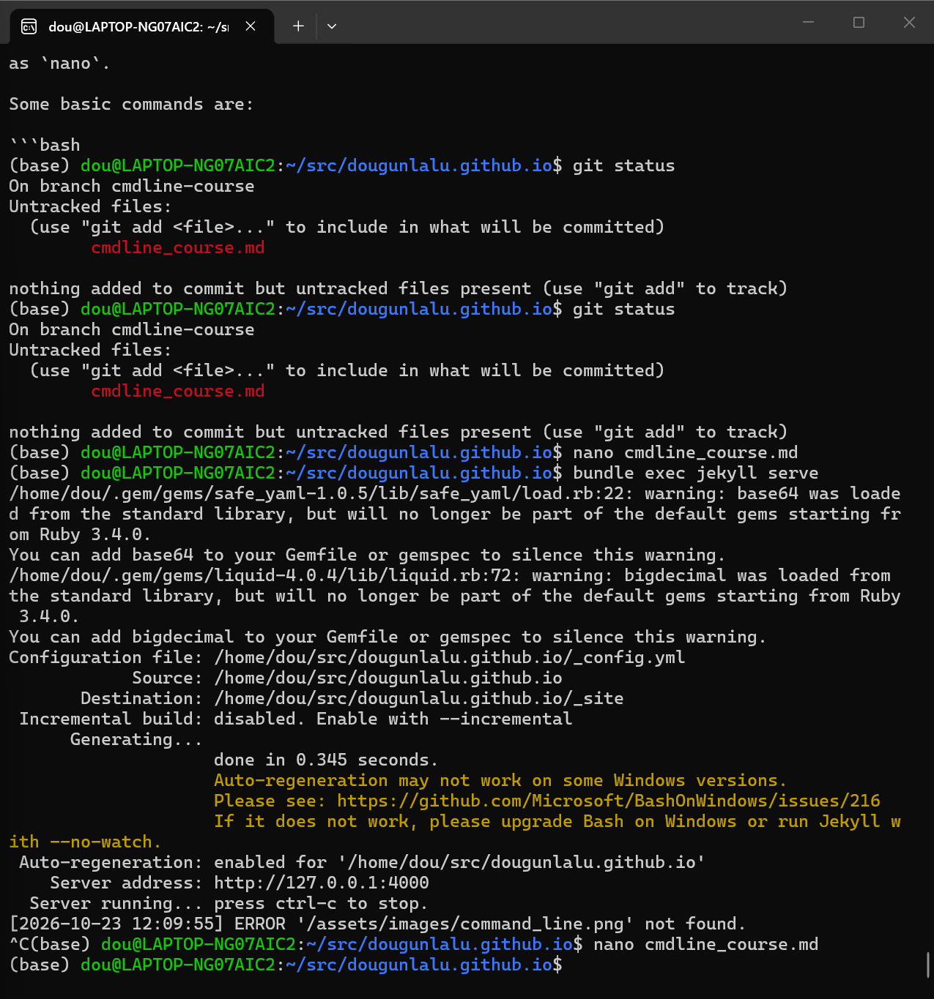

# Command-Line Course

This page summarizes what I learned in the Command-Line Tools course. Before this course, I was not very familiar with Linux commands, but the exercises helped me become more comfortable with the terminal.

## Module 1: Command Line Basics

In the first module, I learned how to navigate the UNIX file system and manage files. I also learned about file permissions and how to use a text editor such as `nano`.

Some basic commands are:

```bash
pwd
ls
cd ..
mkdir test
cp file.txt test/
mv file.txt new_file.txt
rm new_file.txt
```

For example, `pwd` shows the current directory and `ls` shows its contents. At first I found paths a little confusing, but after practicing I became more comfortable using them.

## Module 2: Text Processing

In this module, I learned how to process text files with commands such as `grep`, `sed`, `sort`, `uniq`, `wc`, and `tr`. I also learned about UTF-8, regular expressions, and pipes.

For example:

```bash
sort words.txt | uniq -c | sort -nr
```

This command sorts the words, counts repeated words, and then sorts the result by frequency.

I also practiced regular expressions:

```bash
grep -E '\bbee\b.*\bbee\b' sentences.txt
```

The most useful idea for me was the pipe `|`, because it makes it possible to combine several small commands into one workflow.

## Module 3: Bash Scripts and Installing Programs

In Module 3, I learned how to write simple Bash scripts. I practiced using arguments, variables, `if` statements, and `while` loops.

For example:

```bash
#!/bin/bash

while IFS= read -r line
do
    echo "$line"
done < "$1"
```

I also learned how environment variables work and how settings can be stored in `.bashrc`.

```bash
export GEM_HOME="$HOME/.gem"
export PATH="$PATH:$HOME/.gem/bin"
source ~/.bashrc
```

I also practiced installing programs and packages with tools such as `apt`, `pip`, and `gem`.

## Module 4: SSH, Git and GitHub

In the last module, I learned how to connect to a remote server with SSH and transfer files with SCP.

```bash
ssh username@server.example.fi
scp -r username@server.example.fi:~/remote_dir ~/
```

I also learned the basic Git workflow:

```bash
git status
git add file.txt
git commit -m "Add file"
git push
```

I also practiced branches:

```bash
git switch -c new-branch
git switch master
git merge new-branch
```

Git was confusing at first because there are local files, commits, branches, and remote repositories. After the exercises, I understand the basic workflow much better.

In the final project, I also learned how Jekyll and GitHub Pages can be used to create a website.

```bash
bundle install
bundle exec jekyll serve
```

This command starts a local Jekyll website that can be viewed at `http://127.0.0.1:4000`.

## Some Useful Commands

- `ls` — list files
- `grep` — search text
- `sed` — edit text
- `wc` — count lines or words
- `ssh` — connect to a remote server
- `git` — use version control

## Command Summary

| Command | What it does |
|---|---|
| `pwd` | Shows the current directory |
| `ls` | Lists files |
| `grep` | Searches text |
| `sed` | Edits or transforms text |
| `wc` | Counts lines or words |
| `ssh` | Connects to a remote server |
| `git` | Manages version controlled projects |

## Example Image

Here is an example of working with the command line:



## Final Reflection

This course gave me practical experience with Linux, text processing, Bash, SSH, Git, and GitHub. I still need more practice with some commands, but I now understand the basic workflow and feel more confident using the command line.

