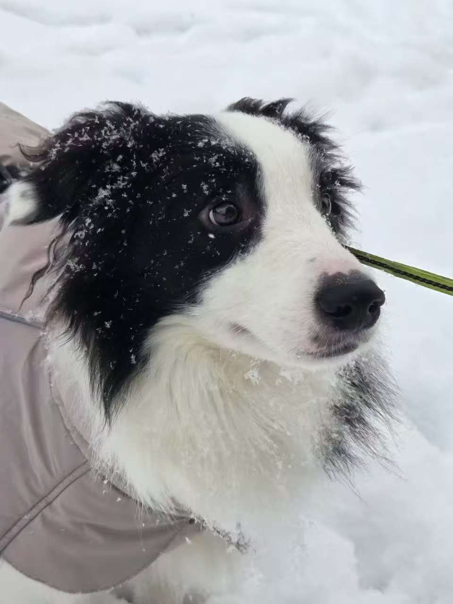

## Introduction

I am a Master's student in Language Technology at Helsinki University. I am particularly interested in multilingual NLP and practical applications of language technology.

## Find me on

[GitHub](https://github.com/dougunlalu)

## Contact

You can contact me through GitHub or email.

## Courses I've Taken

- [Command Line Tools for Linguists](https://studies.helsinki.fi/courses/course-unit/otm-92ee484e-456b-409f-a397-d9d2b6e40a2f)
- [Foundations of Natural Language Processing 2](https://studies.helsinki.fi/courses/course-unit/otm-30271bd3-6b18-40c6-a0de-1f6e752f4718)
- [MAT12001 Tilastotiede ja R tutuksi I](https://studies.helsinki.fi/kurssit/opintojakso/otm-9691c5ad-1b68-4979-a03e-4c454a5f00e0)

## Projects
### Command-Line Course

In this project, I practiced Unix commands, text processing, SSH, Git, and GitHub.

[View the project on GitHub](https://github.com/dougunlalu/cmdline-course)

## Misc. 

I enjoy learning languages.
